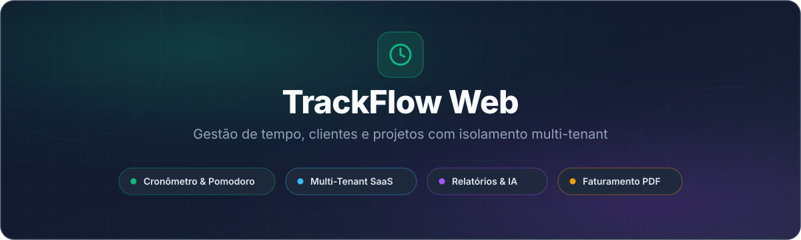

<h1 align="center">TrackFlow Web</h1>

<p align="center">
  
</p>

<p align="center">
  
  
  
  
  
  
  
  
</p>

## Índice

- [Descrição do Projeto](#descrição-do-projeto)
- [Status do Projeto](#status-do-projeto)
- [Funcionalidades do Projeto](#funcionalidades-do-projeto)
- [Demonstração da Aplicação](#demonstração-da-aplicação)
- [Acesso ao Projeto](#acesso-ao-projeto)
- [Abrir e Rodar o Projeto](#abrir-e-rodar-o-projeto)
- [Tecnologias Utilizadas](#tecnologias-utilizadas)
- [Pessoas Contribuidoras](#pessoas-contribuidoras)
- [Pessoas Desenvolvedoras do Projeto](#pessoas-desenvolvedoras-do-projeto)
- [Licença](#licença)

---

## Descrição do Projeto

O **TrackFlow Web** é a aplicação web (SSR/BFF) da plataforma SaaS multi-tenant **TrackFlow**, projetada para gestão de tempo, produtividade e faturamento de equipes e empresas prestadoras de serviço.

Construída com **Node.js**, **TypeScript**, **Express**, **EJS** e **Tailwind CSS**, a aplicação atua como camada de apresentação server-side e *Backend-for-Frontend* (BFF), comunicando-se com a **TrackFlow API** (configurada via `API_URL` e hospedada em produção em [trackflow-api-production.vercel.app](https://trackflow-api-production.vercel.app/)). A sessão do usuário é mantida por meio de cookie JWT HTTP-only (`trackflow_session`), garantindo isolamento multi-tenant e controle de acesso baseado em papéis (`SUPER_ADMIN`, `OWNER`, `MANAGER` e `MEMBER`).

---

## Status do Projeto

<h4 align="center">
  :white_check_mark: Projeto concluído :white_check_mark:
</h4>

---

<a id="funcionalidades-do-projeto"></a>
## :hammer: Funcionalidades do projeto

- `Autenticação e Controle de Acesso (RBAC)`: login tradicional com e-mail e senha, autenticação via **Google OAuth 2.0**, recuperação de senha, troca obrigatória de senha no primeiro acesso (`/first-access`), sessão segura em cookie JWT HTTP-only (`trackflow_session`) e restrição de rotas para os perfis `SUPER_ADMIN`, `OWNER`, `MANAGER` e `MEMBER`.
- `Painel Operacional e Cronômetro Global`: cronômetro em tempo real integrado ao cabeçalho global, criação de apontamentos manuais, edição e exclusão de registros, marcação de horas faturáveis e métricas diárias calculadas no fuso horário BRT (`America/Sao_Paulo`).
- `Modo Pomodoro Integrado`: alternância rápida entre modo Normal e Pomodoro diretamente no cabeçalho, com durações configuráveis de foco e descanso, além de alertas visuais (toast) e notificações no navegador ao concluir cada ciclo.
- `Gestão de Clientes e Projetos`: cadastro, edição e remoção de clientes e projetos, definição de orçamento em reais (`R$`) e horas estimadas, acompanhamento de progresso e custo acumulado, controle de status (`ACTIVE`, `OVER_BUDGET` e `COMPLETED`) e criação rápida de projetos pelo dashboard.
- `Gestão de Equipe`: cadastro, edição e remoção de membros do workspace, definição de taxa horária individual por profissional e consulta ao histórico de atividades do membro (acesso restrito a `OWNER`, `MANAGER` e `SUPER_ADMIN`).
- `Relatórios Financeiros e Faturamento`: visão consolidada mensal por cliente e projeto, exportação de dados em CSV, geração de faturas, visualização e download de PDF, controle de status (`pendente`, `pago`, `cancelado`) e envio de faturas por e-mail via Resend.
- `Inteligência Artificial Integrada`: widget de chat flutuante (`/api/ai/chat`) disponível no workspace e geração automática de resumos executivos e insights com IA para relatórios e faturas.
- `Configurações e Experiência de Uso`: edição de perfil, troca de senha, configuração de taxa horária padrão, moeda e cadência Pomodoro, alternância persistente entre modo claro e escuro (`darkMode: "class"`), filtros dinâmicos em tabelas e layout responsivo para dispositivos móveis.
- `Control Plane SaaS (Super Admin)`: painel administrativo exclusivo (`/control-plane`) com indicadores globais por período, distribuição de tenants por plano, gestão completa de empresas/tenants (criação de Tenant + Owner, alteração de plano e exclusão em cascata) e monitoramento de infraestrutura e logs (Banco Neon, Ollama e Resend).

### Demonstração da Aplicação

> [!TIP]
> Salve capturas de tela ou GIFs das telas em `docs/images/` e descomente o bloco abaixo para exibi-los diretamente no repositório.

<!--
<p align="center">
  
  
</p>
<p align="center">
  
  
</p>
-->

---

<a id="acesso-ao-projeto"></a>
## :file_folder: Acesso ao projeto

- **Repositório do código-fonte (Web):** [github.com/VictorHugoGutierrez/trackflow-web](https://github.com/VictorHugoGutierrez/trackflow-web)
- **API Backend em Produção (`API_URL`):** [trackflow-api-production.vercel.app](https://trackflow-api-production.vercel.app/)

> [!NOTE]
> O **TrackFlow Web** consome os recursos de autenticação, persistência multi-tenant, geração de PDF, IA e envio de e-mails a partir da **TrackFlow API** configurada na variável `API_URL`.

---

<a id="abrir-e-rodar-o-projeto"></a>
## :hammer_and_wrench: Abrir e rodar o projeto

### Pré-requisitos

- **Node.js** `v20+` e **npm**
- **Git** instalado na máquina
- Acesso a uma instância em execução da **TrackFlow API** (local em `http://localhost:3333` ou a instância de produção `https://trackflow-api-production.vercel.app/`)

### Passo a passo para execução local

1. **Clone o repositório:**

   ```bash
   git clone https://github.com/VictorHugoGutierrez/trackflow-web.git
   cd trackflow-web
   ```

2. **Instale as dependências:**

   ```bash
   npm install
   ```

3. **Configure as variáveis de ambiente:**

   Copie o arquivo de exemplo `.env.example` para `.env`:

   ```bash
   cp .env.example .env
   ```

   Preencha o `.env` conforme a tabela abaixo:

   | Variável | Descrição | Exemplo / Padrão |
   | :--- | :--- | :--- |
   | `PORT` | Porta HTTP onde o servidor Express será iniciado | `3000` |
   | `NODE_ENV` | Ambiente de execução (`development` ou `production`) | `development` |
   | `API_URL` | URL base da TrackFlow API consumida pelo BFF | `http://localhost:3333` ou `https://trackflow-api-production.vercel.app` |
   | `JWT_SECRET` | Chave secreta compartilhada com a API para validar o cookie JWT (`trackflow_session`) | `sua_chave_secreta_aqui` |
   | `GOOGLE_CLIENT_ID` | Client ID do Google OAuth 2.0 para habilitar o login com Google | `seu-id.apps.googleusercontent.com` |
   | `RESEND_API_KEY` | Chave da API Resend (opcional no web; o disparo de e-mails ocorre via API) | *(opcional)* |

4. **Inicie o servidor em modo de desenvolvimento:**

   ```bash
   npm run dev
   ```

   O comando compila o Tailwind CSS (`public/css/styles.css`) e inicia o servidor com reload automático via `tsx watch` em `http://localhost:3000`.
   Para verificar rapidamente se o serviço está no ar, acesse `GET /ping` (retorna `{"status":"ok","service":"trackflow-web"}`).

   > [!TIP]
   > Fora do ambiente de produção (`NODE_ENV !== "production"`), há uma rota utilitária `/dev-login` que gera uma sessão JWT local para inspeção rápida de interface (`/dev-login?role=OWNER` ou `/dev-login?role=SUPER_ADMIN`).

5. **Build e execução em modo produção:**

   ```bash
   npm run build
   npm start
   ```

### Scripts disponíveis (`package.json`)

| Script | Comando | Finalidade |
| :--- | :--- | :--- |
| `dev` | `npm run dev` | Compila o CSS e inicia o servidor em modo watch (`tsx watch src/server.ts`) |
| `build` | `npm run build` | Compila o CSS minificado, transpila TypeScript para `dist/` e copia `src/views` para `dist/views` |
| `start` | `npm start` | Executa a aplicação compilada (`node dist/server.js`) |
| `build:css` | `npm run build:css` | Gera o bundle minificado do Tailwind CSS em `public/css/styles.css` |
| `watch:css` | `npm run watch:css` | Observa alterações nos templates e estilos para recompilar o Tailwind CSS |

### Estrutura do Projeto

```text
trackflow-web/
├── api/
│   └── index.ts                 # Entrypoint serverless para deploy na Vercel
├── docs/
│   └── images/
│       └── banner.svg           # Banner visual utilizado no README
├── public/                      # Arquivos estáticos (CSS compilado, JS auxiliar e SVGs)
├── src/
│   ├── controllers/             # Controladores BFF por domínio (auth, dashboard, team, reports, etc.)
│   ├── middlewares/             # Validação de sessão JWT e controle de acesso (RBAC)
│   ├── routes/                  # Definição de rotas Express
│   ├── styles/                  # CSS fonte com diretivas e tokens de tema do Tailwind
│   ├── types/                   # Tipagens TypeScript (usuário, tenant, JWT)
│   ├── utils/                   # Formatadores de moeda, duração e conversão de valores
│   ├── views/                   # Templates EJS (auth, dashboard, projetos, equipe, relatórios, settings, control-plane)
│   └── server.ts                # Configuração principal do servidor Express
├── .env.example                 # Modelo das variáveis de ambiente
├── package.json                 # Dependências e scripts npm
├── tailwind.config.js           # Configuração de cores e dark mode do Tailwind CSS
├── tsconfig.json                # Configuração do compilador TypeScript (ES2022 / NodeNext)
└── vercel.json                  # Rewrites e inclusão das views EJS no deploy Vercel
```

### Deploy na Vercel

O projeto já está preparado para hospedagem serverless na **Vercel** através do arquivo `vercel.json` e do entrypoint `api/index.ts`, que redireciona todas as rotas para o aplicativo Express e garante o empacotamento dos templates EJS (`src/views/**` e `dist/views/**`). Basta configurar as mesmas variáveis de ambiente do `.env` no painel do projeto na Vercel.

---

## Tecnologias Utilizadas

- **[Node.js](https://nodejs.org/)** & **[TypeScript](https://www.typescriptlang.org/)** (`tsx` e módulos ESM) — Runtime e tipagem estática da aplicação.
- **[Express](https://expressjs.com/)** — Servidor HTTP, roteamento e camada BFF (*Backend-for-Frontend*).
- **[EJS](https://ejs.co/)** — Motor de templates para renderização server-side (*SSR*) das páginas e parciais.
- **[Tailwind CSS](https://tailwindcss.com/)** — Estilização utilitária responsiva com suporte a tema claro/escuro (`darkMode: "class"`).
- **[Axios](https://axios-http.com/)** — Cliente HTTP utilizado pelos controladores para comunicação com a TrackFlow API.
- **[jsonwebtoken](https://github.com/auth0/node-jsonwebtoken)** & **[cookie-parser](https://github.com/expressjs/cookie-parser)** — Leitura e validação de sessão via cookie HTTP-only (`trackflow_session`).
- **[Google Identity Services](https://developers.google.com/identity)** — Autenticação integrada com contas Google (OAuth 2.0).
- **[Dotenv](https://github.com/motdotla/dotenv)** — Carregamento de variáveis de ambiente a partir de `.env`.
- **[Vercel](https://vercel.com/)** — Plataforma de deploy serverless configurada via `vercel.json`.

> [!NOTE]
> Recursos como persistência em banco de dados (**Neon PostgreSQL**), motor de Inteligência Artificial (**Ollama**), geração de PDFs de faturas e disparos de e-mail (**Resend**) são processados na **TrackFlow API** e consumidos de forma integrada pelo **TrackFlow Web**.

---

## Pessoas Contribuidoras

Contribuições, sugestões de melhoria e correções de bugs são sempre bem-vindas! Para colaborar com o projeto:

1. Faça um **Fork** deste repositório.
2. Crie uma branch para a sua alteração (`git checkout -b feat/minha-melhoria`).
3. Faça o commit das suas mudanças (`git commit -m "feat: adiciona minha melhoria"`).
4. Envie para a sua branch (`git push origin feat/minha-melhoria`).
5. Abra um **Pull Request** descrevendo claramente o que foi alterado ou reporte um problema na aba **Issues**.

---

## Pessoas Desenvolvedoras do Projeto

| [<br><sub>Victor Hugo Gutierrez</sub>](https://github.com/VictorHugoGutierrez) | [<br><sub>João Cerri</sub>](https://github.com/joaocerri) |
| :---: | :---: |

---

## Licença

Este repositório está configurado como **privado** (`"private": true` em `package.json`) e atualmente **não possui uma licença open-source pública definida** (todos os direitos reservados aos autores). Caso deseje utilizar, distribuir ou adaptar partes deste código, entre em contato com os desenvolvedores responsáveis.
